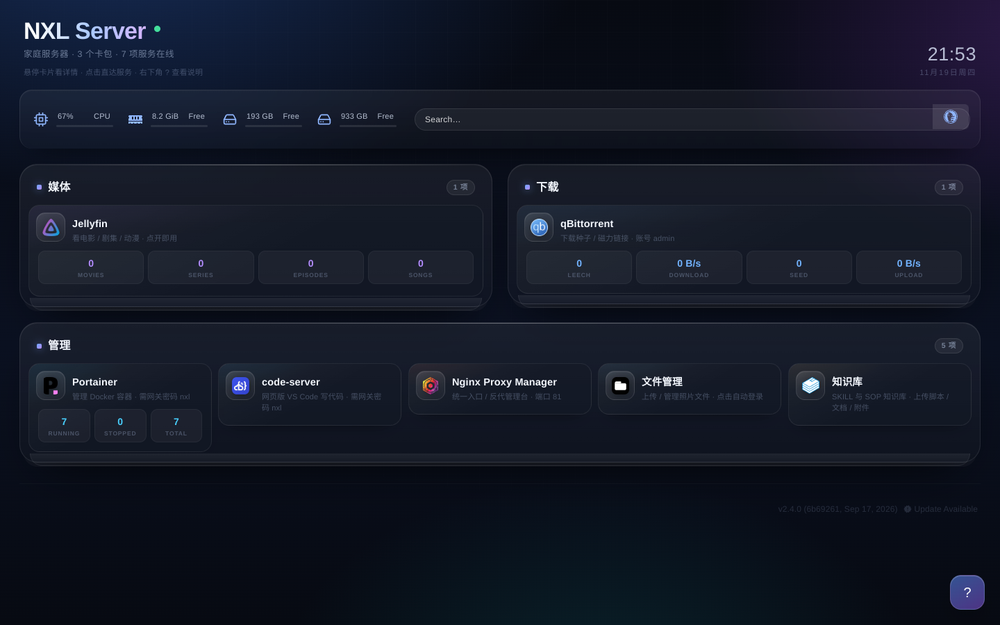

# MyServer · NXL 家庭服务器

一台退役的游戏本，被改造成 7×24 运行的家庭服务器：媒体库、下载、文件与知识库、统一入口，
外加一条正在长大的 AI 鱼（DeepSeek 拟人角色「小肥鱼」）。

本仓库只沉淀**骨架、方案与可复现的配置**，不放密钥、不放运行数据。



## 一眼看全

```
                        家 (192.168.1.88)          外网 (EasyTier 10.144.144.1)
                                │                              │
                                └────────► http://nxl.lan ◄────┘
                                                 │
                                        ┌────────▼─────────┐
                                        │  NPM :80 唯一入口  │
                                        └────────┬─────────┘
      ┌──────────┬───────────┬──────────┬────────┴────────┬──────────┐
     /        /jellyfin  /qbittorrent /files          /portainer   /code
 homepage    jellyfin    qbittorrent  alist(5244)     portainer    code-server(:8081)
 :3000       :8096       :8080        photos/knowledge  :9000       写代码
                                                     (网关密码)   (网关密码)
        │
        └── 卡包式仪表盘（本仓库 homepage/ 下的皮肤）
```

## 当前状态（2026-11-19）

| 模块 | 状态 | 说明 |
|---|---|---|
| Docker 栈 | ✅ 6 容器在跑 | jellyfin / qbittorrent / homepage / npm / portainer / alist |
| 统一入口 | ⚠️ 有条件可用 | NPM `server_name` 只认 `192.168.1.88`，换网段会 404 |
| 网络 | ⚠️ 漂移 | 当前在手机热点 `172.20.10.2`，家里静态 IP 未启用 |
| 仪表盘皮肤 | ✅ 已重做 | Aurora Glass：卡包 + 悬浮展开 + 深色玻璃 |
| 存储 | ⚠️ 单盘无备份 | `/data` 916G 已用 13M；外置 Melon 未挂载 |
| 小肥鱼 | 🟡 半成品 | AstrBot + NapCat(QQ) 已跑；DSH「鱼社」插件未装 |

## 目录

```
.
├── README.md
├── compose/            # 脱敏后的 compose 模板
├── homepage/           # 仪表盘皮肤（custom.css / custom.js）
├── scripts/            # 安装与守护脚本（AstrBot / NapCat / 备份）
├── assets/             # 文档截图
├── docs/
│   ├── 01-架构与网络.md
│   ├── 02-服务清单.md
│   ├── 03-访问入口与鉴权.md
│   ├── 04-前端皮肤.md
│   ├── 05-小肥鱼养成.md
│   ├── 06-运维手册.md
│   ├── 07-路线图.md
│   ├── 08-下游应用皮肤.md
│   └── legacy/         # 历史巡检文档（已脱敏，部分内容过时）
└── .env.example        # 需要你自己填的变量清单
```

## 快速开始

```bash
# 1) 起服务（在服务器上）
cd /data/docker && docker compose up -d

# 2) 看状态
docker compose ps && docker stats --no-stream

# 3) 备份配置（骨架，见 docs/06）
./scripts/backup.sh
```

## 约定

1. **密钥永不入库**：所有口令、API Key 放 `/home/nxl-server/NXL_Server/APIKey.txt`（已 gitignore）或 `.env`。
2. **改配置先改 compose**，再 `docker compose up -d <service>`，最后回来更新 `docs/`。
3. **换 IP 是已知雷区**：入口地址、NPM server_name、AList site_url、首页 href 四处必须一起改（见 `docs/03`）。
4. **数据不放在仓库里**：`/data` 下的媒体、下载、照片、备份都不跟踪。

## 文档索引

| 想知道 | 看 |
|---|---|
| 这台机器什么配置、网络怎么走 | [docs/01-架构与网络.md](docs/01-架构与网络.md) |
| 每个服务干什么、占多少资源 | [docs/02-服务清单.md](docs/02-服务清单.md) |
| 为什么打不开、密码是什么规则 | [docs/03-访问入口与鉴权.md](docs/03-访问入口与鉴权.md) |
| 首页皮肤怎么改 | [docs/04-前端皮肤.md](docs/04-前端皮肤.md) |
| 怎么养小肥鱼 | [docs/05-小肥鱼养成.md](docs/05-小肥鱼养成.md) |
| 出故障怎么救 | [docs/06-运维手册.md](docs/06-运维手册.md) |
| 跳转过去的应用怎么统一 | [docs/08-下游应用皮肤.md](docs/08-下游应用皮肤.md) |
| 接下来做什么 | [docs/07-路线图.md](docs/07-路线图.md) |
