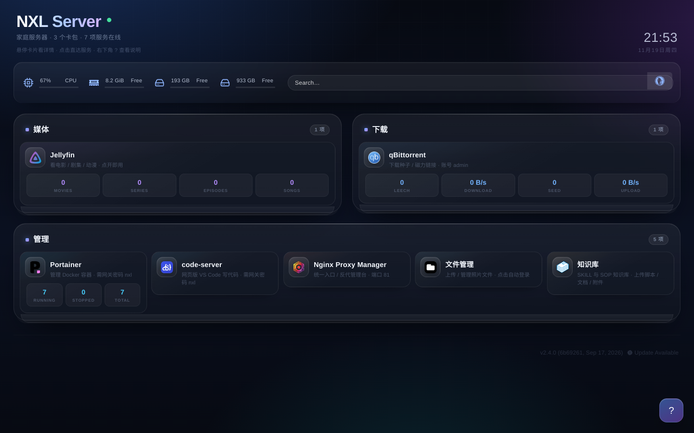

# 04 · 前端皮肤（Aurora Glass）

首页不再是 Homepage 默认的灰列表，而是一套「深空玻璃 + 卡包 + 悬浮展开」的皮肤。
实现方式是对 Homepage 2.4.0 的 DOM 做 CSS/JS 增强，**不 fork、不打补丁**，升级镜像后仍可用。



## 1. 文件与生效方式

| 文件 | 作用 |
|---|---|
| `/data/docker/homepage/config/custom.css` | 全部样式（约 19 KB） |
| `/data/docker/homepage/config/custom.js` | 结构增强 + 交互 + 自动登录（约 10 KB） |
| 本仓库 `homepage/` | 同版本备份 |

Homepage 从 `/api/config/custom.css`、`/api/config/custom.js` 加载这两个文件，**改完刷新页面即可**，不用重启容器。

## 2. 设计 token

| 变量 | 值 | 用途 |
|---|---|---|
| `--ink-0` | `#f4f8ff` | 主文字 |
| `--ink-1` | `rgba(226,236,255,.78)` | 次级文字 |
| `--ink-2` | `rgba(190,208,236,.52)` | 说明文字 |
| `--ink-3` | `rgba(160,180,214,.34)` | 弱化文字 |
| `--stroke` | `rgba(255,255,255,.085)` | 卡片描边 |
| `--accent` | 每个服务各自的主题色 | 光晕、描边、数字 |
| 圆角 | 卡包 26 / 卡片 16 / chip 10 | — |

底色：`#070a12` + 双径向光晕（蓝 `#2e60be`、紫 `#7034a8`）+ 青色补光 + 46px 网格纹理。

## 3. 结构映射（改样式先看这里）

| 视觉 | DOM |
|---|---|
| 卡包容器 | `#layout-groups`（旧版是 `#services`，两种都兼容） |
| 卡包 | `.services-group` |
| 卡包标题 | `.services-group > button` → `.service-group-name` |
| 数量徽标 | `.pck-count`（JS 注入） |
| 牌桌 | `.services-list`（grid，`auto-fit minmax(230px,1fr)`） |
| 单张卡 | `li.service` → `.service-card` |
| 图标 | `.service-icon`（42px 玻璃方块） |
| 名称 / 描述 | `.service-name` / `.service-description` |
| 指标 chip | `.service-block` |
| 悬浮展开行 | `.service-card > .flex.flex-col.pb-1.mx-1` |
| 悬浮提示条 | `.nxl-hint`（JS 注入） |
| 顶部信息条 | `#information-widgets` |
| 使用说明 | `#nxl-fab` + `#nxl-modal`（JS 注入） |

## 4. 布局

```
┌──────────────── Hero（MyServer / 在线数 / 时钟 / 提示）────────────────┐
├──────────────── 信息条：CPU · 内存 · 磁盘 · 搜索 ──────────────────────┤
├──────── 媒体（卡包）────────┬──────── 管理（卡包，占两行，5 张卡）──────┤
├──────── 下载（卡包）────────┤                                          │
└─────────────────────────────┴──────────────────────────────────────────┘
```

- `#services` 是 2 列网格：`nth-child(1)`→左列第 1 行，`nth-child(2)`→左列第 2 行，
  `nth-child(3)`→右列跨两行；第 4 个及以后 `grid-column: 1 / -1` 落到下面通栏
- 这样三个卡包都从首屏顶部开始，不会把「管理」挤到第二行之外
- ≤1000px 退化成单列（按 媒体→下载→管理 顺序竖排）
- 卡片宽度由 `auto-fit` 撑满：窄列一张一行，宽列自动两列

> 标题：`settings.yaml` 的 `title` 在本版本不会改写 `<title>`，所以 `custom.js` 里
> 直接 `document.title = "MyServer"` 兜底，Hero 的 `h1` 也是写死的 MyServer。

## 5. 交互动效

| 动作 | 效果 |
|---|---|
| 页面加载 | 卡片按顺序 `translateY(12px)+fade`，每张延迟 60ms |
| hover 卡包 | 整包上浮 2px，牌边错开，描边变亮 |
| hover 卡片 | `translateY(-3px) scale(1.012)` + 主题色描边 + 外发光 + 图标旋转放大 + 右上角 ↗ |
| hover 卡片 | 展开附加状态行 + 滑出 `.nxl-hint` 提示条（"每张卡都有展开反馈"） |
| 点击「?」 | 右下角悬浮球 → 居中玻璃弹窗（ESC / 点遮罩关闭） |
| 入场 | `prefers-reduced-motion` 时全部关闭 |

## 6. 调参速查

| 想改 | 改哪里 |
|---|---|
| 主题色 | `.nxl-hero-title h1` 的渐变、`.service-group-name::before`、(`--accent` 在 `custom.js` 的 `ACCENTS`) |
| 卡片密度 | `li.service .service-card` 的 `padding`；`.services-list` 的 `minmax(230px,1fr)` |
| 动画强度 | 各处 `transition ... var(--ease)` 的时长；`@keyframes cardIn` |
| 圆角 | `.services-group` / `.service-card` 的 `border-radius` |
| 卡包牌边 | `.services-group::after`（第二层）与 `box-shadow` 里那条 `0 12px 0 -6px` |
| 每张卡的提示文案 | `custom.js` 顶部 `HINTS` 映射 |
| 说明弹窗内容 | `custom.js` 里的 `GUIDE` 数组 |

## 7. 注意

0. **容器 id 会变**：Homepage 2.4.0 的首页容器是 `#layout-groups`，更早是 `#services`。
   选择器一律用 `.services-group` / `li.service` 这类结构选择器，别写 `#services ...`（曾导致
   卡片链接不改写、布局退回默认）。CSS 里同时写 `#layout-groups, #services`。
1. Homepage 用 Tailwind，很多类带 `!` 优先级 —— 覆写时保持 `!important` 习惯。
2. React 会重渲染，JS 注入的节点用 `setInterval(apply, 1500)` + 存在性检查兜底。
3. Homepage 的图标走 `cdn.jsdelivr.net`；断网时图标会空，但不影响功能（可后续改自托管）。
4. 收起附加行用的是 `@media (pointer: coarse)` 判断：触屏常显，鼠标端才折叠。
5. 改完一定要在 1440 宽 + 390 宽各看一遍，卡包列数在 1000px 处切换。

## 8. 隐藏保险箱（连点空白处 10 下）

`custom.js` 里内置了一份凭据清单（`VAULT` 数组），在页面**空白处连续点 10 下**（每下间隔 <800ms）
会弹出「🔐 保险箱」，逐条显示账号、密码可显示/复制。

- 空白处判定：点击目标不是链接、按钮、输入框、服务卡
- 关闭：✕、点遮罩、Esc
- ⚠️ 这是**隐蔽性**不是安全性：密码明文写在 `custom.js` 里，能打开这个页面的人就能拿到。
  以后可以改成口令解锁（比如先问一句只有主人知道的暗号）

条目：统一入口网关 / Jellyfin / qBittorrent / Portainer / NPM 管理台 / AList / code-server。

## 9. 网关密码提示（/portainer、/code）

这两张卡后面有 NPM 网关的 basic auth。点卡片时脚本先 `HEAD` 探一下：

- `401` → 弹「🔑 需要网关密码」：显示账号、密码（可显示/复制），点「继续打开」再走浏览器原生密码框
- 其他（200/302/探测失败）→ 直接开新标签，不打扰

填过一次浏览器会记住，之后点击就是直开。NPM 的鉴权没动过。

## 10. 回滚

```bash
cd /data/docker/homepage/config
cp /home/nxl-server/NXL_Server/backup/homepage-20261119/custom.css .
cp /home/nxl-server/NXL_Server/backup/homepage-20261119/custom.js .
```
