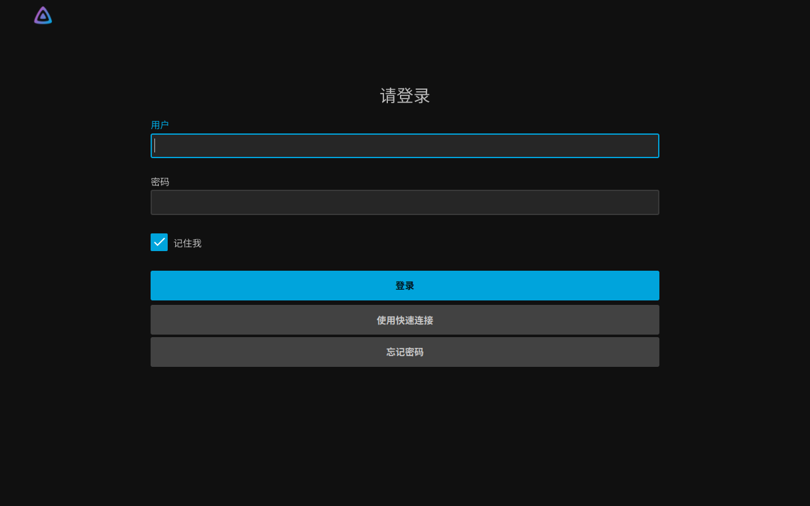
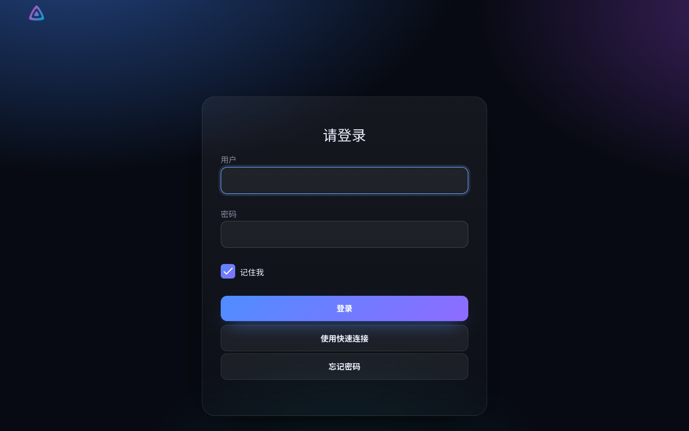
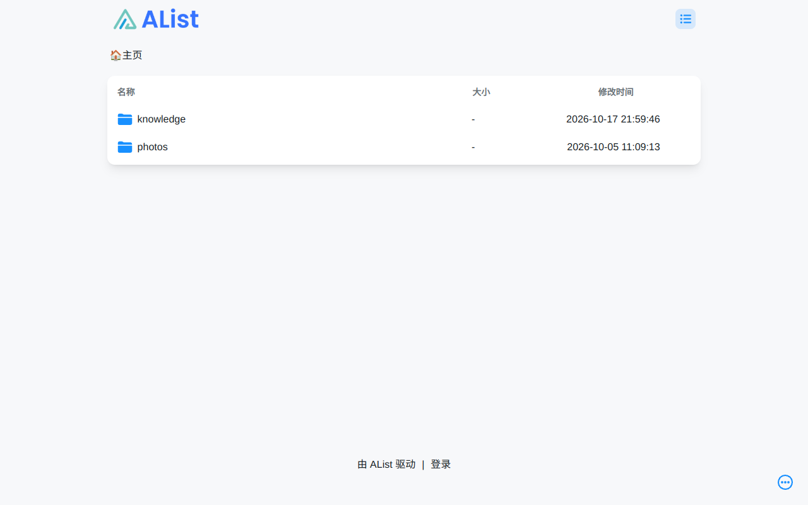
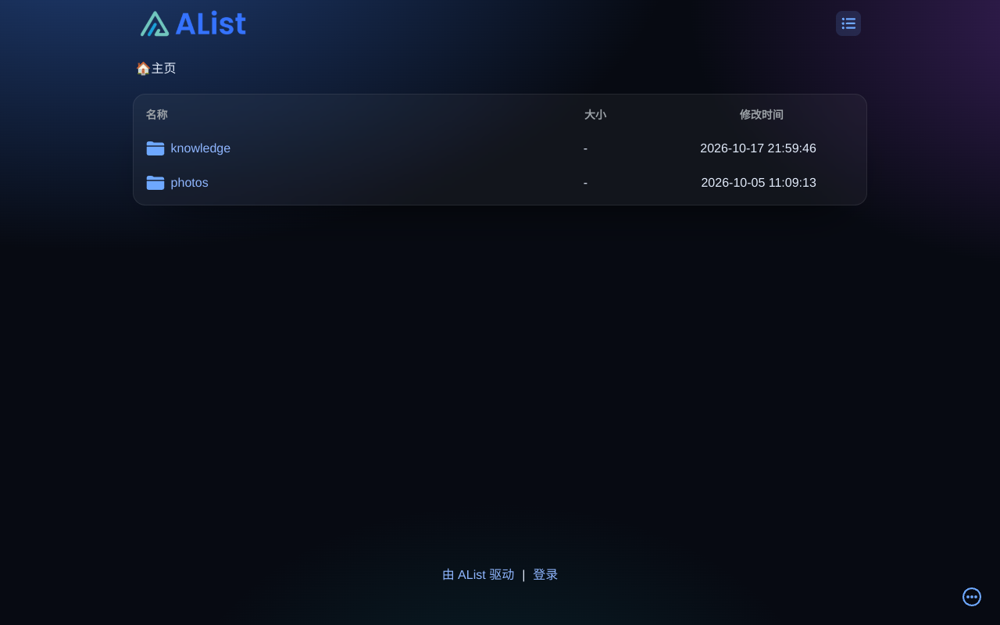

# 08 · 下游应用皮肤（方案 B：原生钩子）

首页改完后，跳转过去的三个应用也统一到同一套「深色玻璃 + 蓝紫强调色」。
**全程只用各应用自带的能力，没碰 NPM、没改镜像、没动系统文件**，全部可一键还原。

| 应用 | 手段 | 风险 | 还原 |
|---|---|---|---|
| Jellyfin | Dashboard 的 `CustomCss`（写入 branding 配置） | 极低 | 再 POST 一次 `CustomCss: ""` |
| AList | 站点设置 `customize_head` + `main_color` | 低 | 清空 `customize_head`、恢复 `main_color` |
| code-server | `settings.json` 的主题与配色 | 无 | 删掉两行配置 |
| qBittorrent / Portainer | ❌ 无原生钩子 | — | 需要方案 A（NPM 注入），待定 |

## 1. Jellyfin

```bash
JELLYFIN_API_KEY=<见 APIKey.txt> ./scripts/apply-skins.sh
# 或手动：
curl -X POST 'http://127.0.0.1:8096/System/Configuration/branding' \
  -H 'Authorization: MediaBrowser Token="<KEY>"' -H 'Content-Type: application/json' \
  -d "$(python3 -c 'import json;print(json.dumps({"SplashscreenEnabled":False,"CustomCss":open("skins/jellyfin.css").read()}))')"
```

做了这些：

- 背景换成深空渐变（`#070a12` + 蓝/紫双光晕）
- **关键坑**：Jellyfin 有一层 `.backgroundContainer`（`#101010`）盖在 `body` 上，
  不清掉它，body 渐变根本看不见 → 必须 `background: transparent !important`
- 登录表单收成居中玻璃卡（24px 圆角、模糊、投影）
- 输入框 / 按钮统一 12px 圆角；主按钮换成蓝紫渐变
- 复选框的青色（`#00a4dc`）改成渐变紫
- 字体换成系统字体栈

改完**不用重启**，刷新页面即生效（服务端 `/Branding/Css` 会返回新内容）。

## 2. AList

AList 没有主题开关，但两件事组合起来就够了：

1. **它自带暗色主题**：`body.hope-ui-light` 换成 `body.hope-ui-dark` 就是完整的官方暗色。
   用 `customize_head` 注入一段脚本，每 1.2 秒兜底把 class 换掉（防止 React 重置）。
2. **站点设置**：`main_color` → `#6ea8ff`，再用 CSS 把顶栏/面包屑融进背景、文件列表做成玻璃卡。

```bash
# 登录拿 token
TOK=$(curl -s -X POST http://172.18.0.2:5244/files/api/auth/login \
  -H 'Content-Type: application/json' \
  -d '{"username":"admin","password":"<网关密码>"}' | python3 -c 'import json,sys;print(json.load(sys.stdin)["data"]["token"])')

# 保存（注意：save 接口要传「数组」，传对象会 400 "decode slice"）
python3 - <<'PY'
import json,urllib.request
tok=open('/tmp/alist.tok').read().strip()
head=open('skins/alist-head.html').read()
items=[{"key":"main_color","value":"#6ea8ff"},{"key":"customize_head","value":head}]
req=urllib.request.Request("http://172.18.0.2:5244/files/api/admin/setting/save",
  data=json.dumps(items).encode(),method="POST",
  headers={"Authorization":tok,"Content-Type":"application/json"})
print(urllib.request.urlopen(req,timeout=10).read().decode())
PY
```

> AList 没有发布宿主机端口，所以用它容器 IP（`docker inspect alist` → `172.18.0.2`）或走 NPM `/files`。

## 3. code-server

只改编辑器，不动代码：

```json
{
  "workbench.colorTheme": "Default Dark Modern",
  "workbench.colorCustomizations": {
    "titleBar.activeBackground": "#0b1220",
    "activityBar.background": "#0b1220",
    "sideBar.background": "#0b1220",
    "statusBar.background": "#0b1220",
    "focusBorder": "#6ea8ff",
    "button.background": "#4f8dff"
  }
}
```

文件：`~/.local/share/code-server/User/settings.json`（改完刷新页面即生效）。

⚠️ **登录页改不了**：那是 code-server 服务端渲染的静态 HTML（`/usr/lib/code-server`），
要动就得改系统文件（需 sudo、升级会被覆盖）。好在首页卡片会自动登录，通常看不到它。

## 4. qBittorrent 与 Portainer

两个都是亮白登录页，而且**都没有自定义 CSS 的能力**（qB 只支持换一整套 WebUI，Portainer 没有钩子）。

要统一只能上方案 A：NPM `sub_filter` 注入共享 `nxl-skin.css`。
风险点是 NPM 配置，做之前必须：

```bash
docker exec npm cp /data/database.sqlite /data/database.sqlite.bak
```

## 5. 截图

| 改前 | 改后 |
|---|---|
|  |  |
|  |  |
